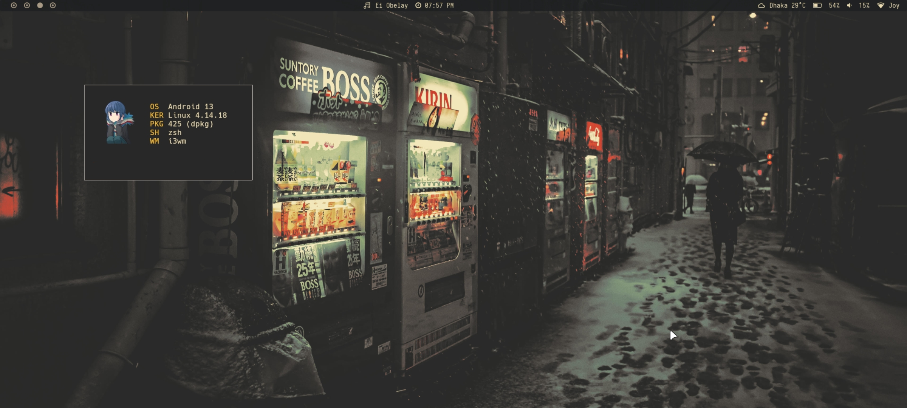

# 🔧 My Dotfiles

> *Configuration files (.dotfiles) for Linux and Termux*

<div align="center">

A carefully crafted collection of configuration files featuring window manager, terminal, themes, and polybar with custom modules for Termux.



</div>

---

## 📦 Installation

### Required Packages for Termux

Before using these dotfiles on Termux, install the required packages:

```bash
pkg update && pkg upgrade
 ```

## 📖 Configuration Documentation

### 🎯 Modifier Key

<div align="center">

The `$mod` key is configured as **Mod1** (Alt key)

</div>

> **Note:** Also you can you **Mod2** (Windows key)
---

## 🚀 Application Shortcuts

### Core Applications

<div style="overflow-x: auto;">

| Shortcut | Action | Description |
|----------|--------|-------------|
| `Alt+Return` | Open Kitty terminal | Launch your primary terminal emulator |
| `Alt+e` | Open Thunar file manager | Access your file system with ease |
| `Alt+Space` | Launch Rofi application menu | Quick application launcher |

</div>

### Window Management

<div style="overflow-x: auto;">

| Shortcut | Action |
|----------|--------|
| `Alt+q` | Close focused window |

</div>

---

## 🧭 Window Focus

<div align="center">

Navigate between windows with intuitive key combinations:

</div>

### Directional Movement

<div style="overflow-x: auto;">

| Direction | Primary Shortcut | Alternative |
|-----------|------------------|-------------|
| **Left** | `Alt+j` | `Alt+Left` |
| **Down** | `Alt+k` | `Alt+Down` |
| **Up** | `Alt+l` | `Alt+Up` |
| **Right** | `Alt+;` | `Alt+Right` |

</div>

---

## 🎨 Layouts and Splits

<div align="center">

Master your workspace organization:

</div>

### Window Splitting
- `Alt+h` → **Split window horizontally**
- `Alt+v` → **Split window vertically**

### Layout Management
- `Alt+f` → **Toggle fullscreen mode**
- `Alt+w` → **Switch to tabbed layout**
- `Alt+s` → **Toggle between split and stacking layouts**

### Advanced Controls
- `Alt+Shift+Space` → **Toggle floating mode** for the focused window
- `Alt+Shift+t` → **Toggle focus mode** (tree/tiling)
- `Alt+a` → **Focus parent container** in layout hierarchy

---

## ⚙️ Reload & Restart i3

<div align="center">

Keep your configuration up-to-date:

</div>

<div style="overflow-x: auto;">

| Shortcut | Action | Purpose |
|----------|--------|---------|
| `Alt+Shift+z` | Reload i3 configuration | Apply changes without restart |
| `Alt+Shift+r` | Restart i3 | Full restart without logging out |

</div>

---

